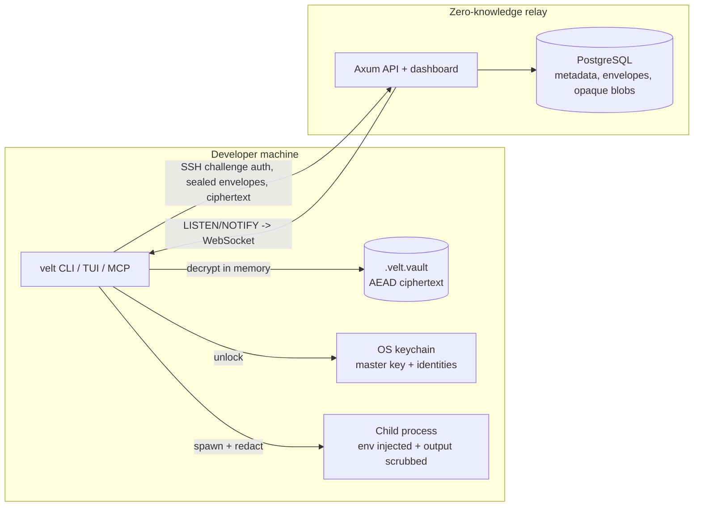

# Velt

**Zero-knowledge secret execution for humans and agents.**

Velt replaces plaintext `.env` files with an authenticated encrypted vault, injects secrets only into the child process that needs them, redacts them from captured output, and syncs team environments with end-to-end encryption. The relay server never receives a plaintext secret or a team key.

```
velt run -- npm run dev
```

Velt is local-first: no account is required for local secrets, auditing, leases, the TUI, or the MCP server. Team sync is opt-in.

---

## What is implemented

| Area | Capabilities |
| --- | --- |
| Encrypted local vault | ChaCha20-Poly1305, random per-write nonces, AAD-bound header, SHA-256 payload checksum, atomic 0600 writes, advisory locking |
| OS keychain | macOS Keychain, Windows Credential Manager, Linux Secret Service via `keyring`; key material zeroized with `zeroize` |
| Process injection | `velt run -- <cmd>`, inherited environment with vault overrides, signal forwarding, exact child exit codes |
| Output redaction | Streaming stdout/stderr scrubbing of raw, percent-encoded, base64, JSON-escaped and hex forms; `--redact auto|always|never` |
| Audit | Placeholders, empty/short/low-entropy values, expiry metadata, JWT `exp`, live credential formats, inline private keys, duplicate values, plaintext `.env` files, permissions, `.gitignore` coverage |
| Rule packs | JSON regex rules with optional Ed25519 detached signatures |
| Recovery | Shamir's Secret Sharing over GF(2^8), configurable threshold/total, checksummed and vault-bound shares |
| TUI | ratatui editor with masking, reveal, add/edit/delete, dirty-state confirmation, explicit save |
| Agent harness | `--llm-docs`, MCP stdio server, scoped HMAC leases, human-in-the-loop secret requests, guardrail injection into agent rule files |
| Team sync | SSH Ed25519 challenge auth, X25519 + HKDF + ChaCha20-Poly1305 sealed team keys, opaque encrypted blobs, optimistic versions, Postgres LISTEN/NOTIFY WebSocket events |
| Governance | Owner/admin/developer/CI-bot roles, environment grants, audit trail, member revocation, client-driven key rotation |
| Dashboard | Server-rendered team/member/environment/audit views, one-time CLI login, CSRF protection, audit CSV, revocation |
| Deployment | Docker image, compose stack, migrations embedded in the binary, health/readiness endpoints |

There is no billing, hosted service, OIDC/SAML SSO, or CI-provider integration in this repository. See [Limitations](#limitations).

---

## Build

Requirements: Rust 1.88+ (stable), and on Linux the Secret Service development headers (`dbus-1`) for `keyring`.

```bash
git clone https://github.com/AdarshJ173/velt.git
cd velt
cargo build --release -p velt
./target/release/velt --help
```

Install the binary somewhere on `PATH`:

```bash
install -m 0755 target/release/velt ~/.local/bin/velt
```

Build the relay:

```bash
cargo build --release -p velt-server
```

---

## Quick start

```bash
cd your-project
velt init                 # detects the stack, imports .env, writes .velt.vault
velt set STRIPE_KEY --stdin
velt inspect --json       # names/types/status, never values
velt run -- npm run dev   # injects secrets, redacts captured output
velt audit                # exits 1 on findings at or above --fail-on (default: error)
velt edit                 # interactive ratatui editor
```

`velt init`:

- detects Node.js/Next.js/Astro/Nuxt/Remix/SvelteKit/Express, Rust/Axum/Actix, Python/FastAPI/Django/Flask, Go/Gin/Echo/Fiber, Deno, Ruby/Rails and Docker;
- imports an existing `.env`, including `export`, quotes, escapes and inline comments;
- asks before shredding the plaintext `.env` (best-effort overwrite + unlink; SSD copies may remain);
- writes agent guardrails to `.cursorrules`, `.windsurfrules`, `CLAUDE.md`, `.github/copilot-instructions.md` and a project `.mcp.json`;
- updates `.gitignore` for `.env*` and local request metadata.

Use `--no-agent-files`, `--keep-env`, `--shred-env`, `--no-import-env`, or `--force` as needed.

---

## Local commands

```text
velt init [--force] [--keep-env|--shred-env] [--no-import-env] [--no-agent-files]
velt set KEY [VALUE] [--stdin] [--expires 30d|2027-01-01|never]
velt get KEY [--no-newline]
velt list
velt remove KEY [--yes]
velt run [--redact auto|always|never] [--lease TOKEN] -- COMMAND...
velt audit [--json] [--fail-on error|warning|info|never] [--no-files]
           [--rules FILE [--rules-signature FILE --rules-public-key HEX]]
velt inspect [--json] [--require KEY[,KEY]]
velt schema                     # alias for inspect
velt edit
velt recovery create [--threshold 2] [--shares 3] [--out-dir DIR]
velt recovery restore SHARE_FILE...
```

`--vault PATH` / `VELT_VAULT` override discovery. Without it, Velt walks upward from the current directory to find `.velt.vault`.

### Expiry and audit exit codes

`--expires` accepts `90s`, `15m`, `12h`, `30d`, `2w`, combinations like `1h30m`, RFC 3339 timestamps, dates, Unix seconds, or `never`.

`velt audit` exits `1` when a finding is at or above `--fail-on` (default `error`). JSON output is stable and never includes secret values. `velt inspect --require KEY` exits `1` when a required key is missing, which is safe to use in CI.

---

## Agent-native features

### Token-optimized docs

```bash
velt --llm-docs
```

### MCP server

```bash
velt mcp                 # execute + inspect tools
velt mcp --read-only     # no command execution
```

MCP is JSON-RPC 2.0 over stdio. Tools:

- `velt_inspect` – names, types, status; never values
- `velt_audit` – offline findings
- `velt_run` – command array, optional cwd/lease/timeout; output is always redacted and captured
- `velt_lease_create` – scoped, expiring HMAC capability
- `velt_request_secret` / `velt_request_status` – human-in-the-loop requests

Resources: `velt://vault/schema`, `velt://vault/audit`, `velt://docs/llm`.

### Scoped leases

```bash
TOKEN=$(velt lease create --allow 'STRIPE_*' --deny 'STRIPE_PROD_*' --ttl 10m --json | jq -r .token)
velt run --lease "$TOKEN" -- node scripts/checkout.js
```

A lease is an HMAC-SHA256 bearer token signed with a per-vault key stored in the OS keychain. It limits which vault-managed variables are injected and redacted. It is not a sandbox: any process running as the same OS user can ask Velt for a different lease.

### Human-in-the-loop requests

```bash
velt request OPENAI_API_KEY --reason "embedding pipeline" --json
velt request --list
velt request --fulfill <id>        # hidden prompt; writes the value locally
velt request --status <id>
velt request --deny <id>
```

Request metadata lives in `.velt/requests/` and never contains secret values. Optional notifications use `notify-send` or a Slack webhook (`VELT_SLACK_WEBHOOK_URL`).

### Redaction scope

`--redact auto` (default) captures and scrubs when stdout or stderr is not a TTY; `always` forces capture; `never` inherits both streams.

Redaction is defense-in-depth, not confinement. It cannot stop hashing, encryption, character-wise output, file writes, network exfiltration, or values shorter than 4 bytes. Use an OS/container sandbox when that matters.

---

## Team sync

### 1. Run a relay

For local evaluation, use the compose stack:

```bash
docker compose up --build
# relay: http://127.0.0.1:8080
```

Production deployment, TLS, backups and scaling are covered in [docs/DEPLOYMENT.md](docs/DEPLOYMENT.md).

### 2. Authenticate

```bash
velt auth register --server https://sync.example.com --username alice --ssh-key ~/.ssh/id_ed25519
velt auth status
```

Authentication is passwordless: the relay issues a random challenge, the CLI signs it with the SSH key, and the relay verifies the registered public key. Sessions are opaque tokens stored in the OS keychain.

### 3. Create a team and bind a vault

```bash
velt team create acme
velt sync init --team <team-id> --env production
velt sync push
```

### 4. Invite a teammate

```bash
velt team invite bob --role developer --env production
# or, from a bound vault:
velt share bob
```

The team key is wrapped for Bob with an ephemeral X25519 key, HKDF-SHA256 and ChaCha20-Poly1305. The relay stores only the sealed envelope.

### 5. Pull, watch and rotate

```bash
velt sync pull            # refuses to overwrite unpushed local changes
velt sync pull --merge    # remote wins conflicts, local-only keys are kept
velt sync watch           # WebSocket change notifications
velt team rotate-key      # re-encrypt every environment after revocation
velt team remove bob --yes
velt team audit --json
```

### 6. Dashboard

```bash
velt dashboard
# open the printed URL within 5 minutes and press Continue
```

The dashboard can review teams, members, environment versions and audit events, update roles/grants, revoke members and download CSV. It cannot decrypt secrets or rotate keys.

---

## Security model

- The local vault is authenticated ciphertext. A wrong key, tampered byte, truncated file or mismatched header fails closed.
- The master key is random, not derived from a password, and lives only in the OS credential store. Copying `.velt.vault` to another account does not grant access.
- Velt zeroizes key material and plaintext payload buffers. It does not currently `mlock` memory; the OS may swap it.
- Secrets are injected into the child environment. Other processes running as the same user may inspect `/proc/<pid>/environ` or process memory; Velt does not prevent that.
- The relay sees team names, usernames, public keys, environment names, versions, sizes and access times. It does not see secrets or team keys.
- Revocation is enforced by the relay, but a removed member may still possess old ciphertext and old keys. Rotate the team key after revocation.
- Recovery shares are equivalent to the master key. Store them offline and separately.
- The audit engine is offline and heuristic. It does not query public leak feeds.

Full threat model and non-goals: [docs/SECURITY.md](docs/SECURITY.md).

---

## Architecture



- [docs/ARCHITECTURE.md](docs/ARCHITECTURE.md)
- [docs/VAULT_FORMAT.md](docs/VAULT_FORMAT.md)
- [docs/SYNC_PROTOCOL.md](docs/SYNC_PROTOCOL.md)
- [docs/AGENT.md](docs/AGENT.md)
- [docs/DEPLOYMENT.md](docs/DEPLOYMENT.md)

---

## Repository layout

```text
crates/velt-core     vault format, AEAD, keychain, audit, recovery, leases, E2EE primitives
crates/velt-cli      CLI, TUI, redaction, MCP, requests, sync client, dashboard link
crates/velt-server   Axum relay, PostgreSQL schema, auth, RBAC, events, dashboard
deploy/              Dockerfile, compose stack
docs/                architecture, format, protocol, security, deployment, agents
```

---

## Limitations

These are deliberate boundaries of the current implementation, not hidden stubs:

- No hosted SaaS, billing, seat metering, OIDC/SAML SSO, SCIM, Jira/VPN ABAC, or Slack approval workflow.
- No GitHub Actions/Vercel secret-push integrations. `velt run` is the CI injection primitive; machine-token bootstrap for headless CI is not implemented.
- The relay uses PostgreSQL `LISTEN/NOTIFY` for fan-out instead of Redis Pub/Sub. This keeps the stateless-server design without another datastore.
- Redaction is best-effort and documented above.
- No memory locking (`mlock`) or process sandboxing.
- Dashboard exports CSV, not PDF.
- Custom rule packs can be signature-verified, but there is no hosted rule-update feed.
- Linux keychain access requires an unlocked Secret Service session (GNOME Keyring/KWallet). Headless servers need a session keyring or a CI-specific design that is not included.
- The name “Velt” has prior use in the collaboration-SDK space; trademark/domain clearance is required before commercial launch.

---

## License

MIT. See [LICENSE](LICENSE).

Security reports: see [docs/SECURITY.md](docs/SECURITY.md).
