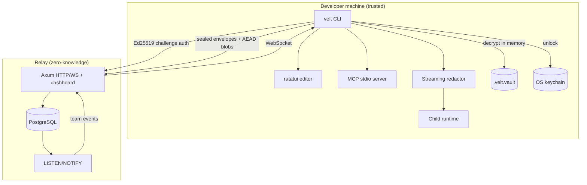

# Architecture

## System overview

Velt has three deployable surfaces and one shared cryptographic core.

## Local architecture

### Vault

- One `.velt.vault` per project. The file is a binary header plus ChaCha20-Poly1305 ciphertext.
- The master key is a random 256-bit value stored in the OS credential store under `vault:<vault-id>`.
- The payload is JSON with a BTreeMap of entries, timestamps, revision, key version, optional team binding, and a SHA-256 checksum.
- Reads are bounded (16 MiB), require a regular file, and authenticate the header as AAD.
- Writes use a temporary file in the same directory, `fsync`, atomic rename, and 0600 permissions on Unix.
- `VaultLock` provides an advisory lock in the OS temp directory, keyed by the canonical vault path, for read-modify-write commands.

### Process injection

`velt run`:

1. discovers and decrypts the vault;
2. applies an optional lease filter;
3. removes vault-managed names from the inherited environment unless granted;
4. sets the granted variables on `std::process::Command`;
5. spawns the child, forwards `SIGINT`/`SIGTERM`/`SIGHUP`/`SIGQUIT` on Unix, and exits with the child's code (`128 + signal` if killed);
6. when redaction is active, reads both output pipes through a streaming scrubber and writes to the parent's stdout/stderr.

The child environment is visible to same-user processes on Linux (`/proc/<pid>/environ`). Velt does not claim otherwise.

### Redaction

- Patterns are the injected secret values plus percent-encoded, base64, JSON-escaped and hex representations.
- Aho-Corasick `LeftmostLongest` matching with a carry buffer handles matches spanning read boundaries.
- Secrets shorter than 4 bytes and longer than 64 KiB are not redacted (documented tradeoff).
- This is DLP, not a sandbox. A child can hash, chunk, encrypt or exfiltrate a secret.

### Agent features

- MCP is a blocking JSON-RPC 2.0 loop over stdio. stdout is protocol-only.
- `velt_run` captures and redacts output; it never streams child output into the JSON-RPC transport.
- Leases are HMAC-SHA256 tokens over JSON claims; verification is offline. The signing key is per vault and stays in the keychain.
- Requests are local JSON metadata; fulfillment requires a human terminal prompt (or explicit stdin).
- `velt init` installs idempotent guardrail blocks into common agent rule files and a project `.mcp.json`.

### TUI

`ratatui` + `crossterm`. The editor holds the vault write lock for its lifetime, masks values by default, and requires explicit save (`s`). Quitting with unsaved changes requires confirmation. A `TerminalGuard` restores raw mode and the alternate screen on every exit path, including errors.

## Relay architecture

- Stateless Axum API instances.
- PostgreSQL is the system of record: users, auth challenges, sessions, teams, memberships, envelopes, opaque blobs, audit events, dashboard tokens/sessions.
- `pg_notify` + `PgListener` fan out team events to every instance, which broadcast to WebSocket subscribers. No Redis dependency is required.
- The relay never receives a team key or plaintext. It cannot satisfy a subpoena for secrets it does not hold.
- Dashboard is server-rendered HTML with no JavaScript, CSP `default-src 'none'`, HttpOnly `SameSite=Strict` cookies, and per-session CSRF tokens.

## Trust boundaries

| Boundary | Trusted | Untrusted |
| --- | --- | --- |
| Local vault | OS keychain, Velt binary | Vault file, project directory |
| Process injection | Parent process | Child process and its output |
| Team sync | Member devices holding team keys | Relay, network, database |
| Dashboard | CLI-issued one-time link, session cookie | Browser input, cross-site requests |
| Agent | Local policy, lease issuer | MCP client, model-generated commands |

## Failure behavior

- Wrong key / tampered ciphertext → authentication failure, no partial plaintext.
- Missing keychain entry → actionable error; recovery shares are the recovery path.
- Server version conflict → 409, no silent overwrite.
- Removed member → relay denies future pulls; key rotation is required to invalidate retained ciphertext.
- Event listener failure → relay startup fails (real-time consistency is part of the service contract); health endpoints remain independent.
